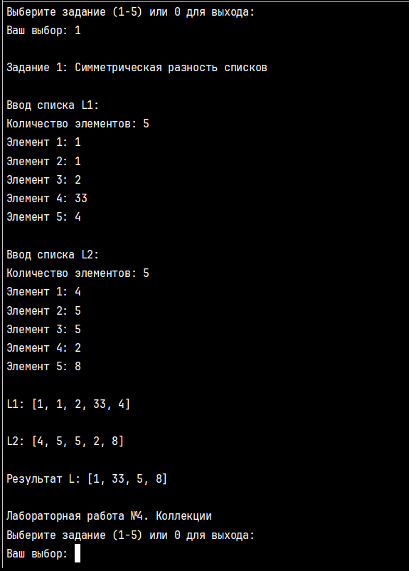
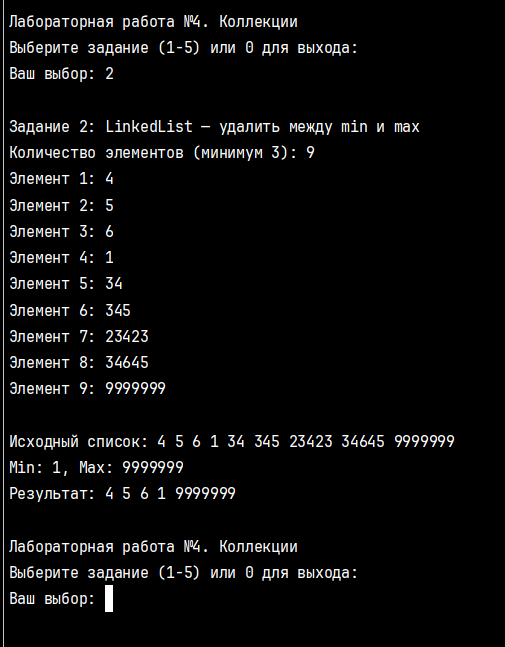
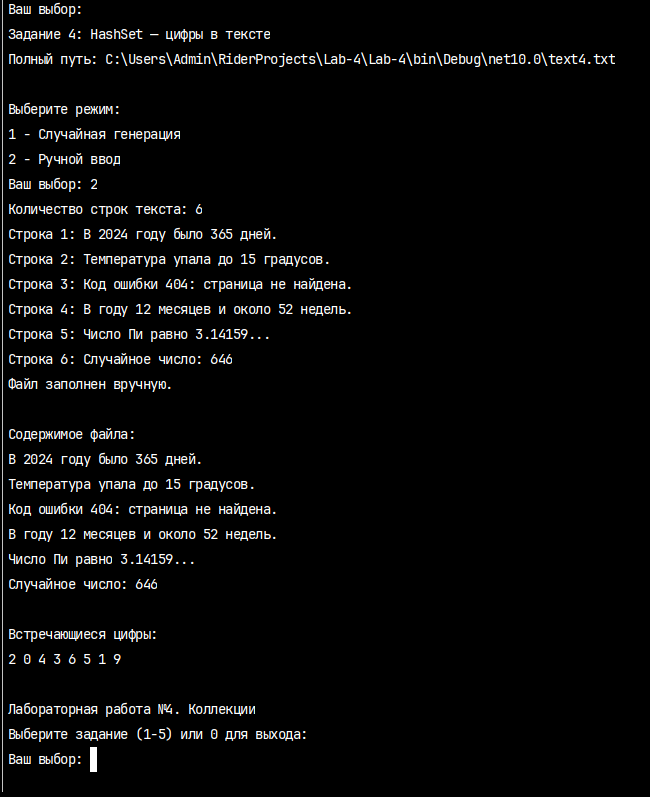
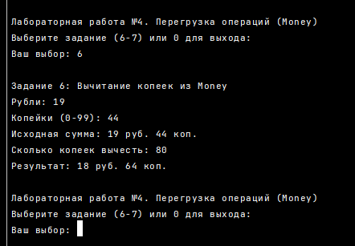
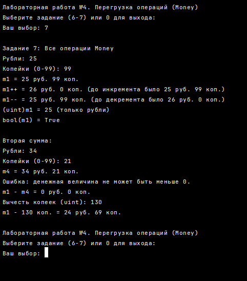

# Лабораторная работа №4 — Коллекции и перегрузка операций

**Автор:** Чичарин Денис, ИТ-2  
**Вариант:** 13  

---

## Общие требования и ограничения
При выполнении лабораторной работы строго соблюдены следующие требования:
- Запрещено использование автосвойств, LINQ-запросов и лямбда-операторов.
- Все переменные инициализируются до их первого использования.
- Реализована строгая валидация всех вводимых пользователем данных (проверка диапазонов, форматов, защита от дубликатов).
- Для работы с файлами используется конструкция `try/finally` для гарантированного освобождения ресурсов.
- Задание 5 реализовано с оптимальной алгоритмической сложностью **O(n)** (в один проход, без сортировки).

---

## Задание 1. List — Симметрическая разность

### Текст задачи
Составить программу, которая формирует список `L`, включив в него по одному разу элементы, которые входят в один из списков `L1` и `L2`, но в то же время не входят в другой из них.

### Алгоритм решения
1. Считать два списка целых чисел `L1` и `L2` с клавиатуры с проверкой на корректность ввода.
2. Создать пустой результирующий список `L`.
3. Пройти циклом по всем элементам `L1`. Для каждого элемента проверить два условия с помощью линейного поиска (метод `ContainsInt`):
   - Элемента нет в `L2`.
   - Элемента ещё нет в результирующем списке `L` (гарантирует требование "по одному разу", исключая дубликаты).
   - Если оба условия истинны, добавить элемент в `L`.
4. Повторить аналогичную процедуру для элементов списка `L2` (проверка на отсутствие в `L1` и в `L`).
5. Вывести исходные списки и результирующий список `L`.

### Тестирование

---

## Задание 2. LinkedList — Удаление элементов между min и max

### Текст задачи
Удалить все элементы между минимальным и максимальным элементами двусвязного списка.

### Алгоритм решения
1. Считать элементы в `LinkedList<int>`, предварительно проверив, что их количество не менее 3.
2. Выполнить один проход по списку для поиска узлов с минимальным (`minNode`) и максимальным (`maxNode`) значениями.
3. Определить порядок следования узлов: найти, какой из них (`minNode` или `maxNode`) встречается в списке первым. Обозначить их как `first` и `last`.
4. Если `first` и `last` являются соседними узлами (`first.Next == last`), вывести сообщение, что удалять нечего.
5. В противном случае, начать с узла `toDelete = first.Next` и в цикле `while (toDelete != last)` удалять текущий узел из списка (`list.Remove`) и переходить к следующему (`toDelete = next`).
6. Вывести модифицированный список.

### Тестирование

---

## Задание 3. HashSet — Анализ предпочтений телезрителей

### Текст задачи
Есть перечень названий телевизионных шоу. Определить для каждого наименования шоу, какие из них нравятся всем $n$ телезрителям, какие — некоторым из телезрителей, и какие — никому из телезрителей.

### Алгоритм решения
1. Считать количество шоу в общем перечне и их названия. Реализовать проверку на уникальность названий (регистронезависимое сравнение).
2. Считать количество телезрителей $n$.
3. Создать целочисленный массив `likesCount` размером с количество шоу, инициализированный нулями.
4. Для каждого зрителя вывести нумерованный список доступных шоу. Запросить ввод номеров любимых шоу через пробел.
5. Разбить строку ввода методом `Split(' ')`, преобразовать элементы в числа с помощью `int.TryParse`. Игнорировать некорректный ввод, дубликаты выбора в рамках одного зрителя и номера вне диапазона. Для валидных номеров увеличивать соответствующий счётчик в `likesCount`.
6. После опроса всех зрителей классифицировать шоу по трём спискам:
   - `likesCount[i] == n` → нравятся всем.
   - `likesCount[i] > 0` и `< n` → нравятся некоторым.
   - `likesCount[i] == 0` → не нравятся никому.
7. Вывести результаты по категориям.

### Тестирование

---

## Задание 4. HashSet — Цифры в тексте

### Текст задачи
Файл содержит текст на русском языке. Определить, какие цифры встречаются в тексте. Заполнение файла организовать отдельным методом (выбор между генерацией и ручным вводом).

### Алгоритм решения
1. Предложить пользователю выбрать режим заполнения файла: случайная генерация или ручной ввод.
2. В режиме генерации записать в файл массив заранее подготовленных строк и одно случайное число. В режиме ручного ввода запросить количество строк и считать их с клавиатуры.
3. Открыть файл для чтения с использованием конструкции `try/finally` для гарантированного вызова `reader.Close()`.
4. Создать `HashSet<char> digits` для хранения уникальных найденных цифр.
5. Читать файл построчно. Для каждой строки пройти циклом по всем символам.
6. Если `char.IsDigit(line[i])` возвращает `true`, добавить символ в `HashSet`.
7. Вывести содержимое файла и итоговый набор уникальных цифр.

### Тестирование

---

## Задание 5. Dictionary/SortedList — Самый старший человек

### Текст задачи
Имеется список людей с указанием их фамилии, имени и даты рождения. Определить самого старшего человека. Если таких людей несколько, определить их количество и вывести их данные. Формат даты: `ДД.ММ.ГГГГ`.

### Алгоритм решения (Оптимальный, O(n))
1. Считать количество людей $N$.
2. Инициализировать переменную `oldestDate` значением `DateTime.MaxValue` и пустой список `oldestPeople` для хранения кандидатов.
3. В цикле от 1 до $N$:
   - Считать фамилию и имя с ограничением длины до 20 символов.
   - В цикле `while` считать строку даты и пытаться распарсить её методом `ParseDate`, который разделяет строку по точке и валидирует диапазоны (день 1-31, месяц 1-12, год 1800-2100).
   - Если парсинг успешен, сравнить `birthDate` с `oldestDate`:
     - Если `birthDate < oldestDate`: обновить `oldestDate`, очистить список `oldestPeople` и добавить текущего человека.
     - Если `birthDate == oldestDate`: просто добавить текущего человека в список `oldestPeople`.
4. После цикла вывести дату и либо одного человека, либо количество людей с одинаковой датой и их список.
*Примечание: Алгоритм работает за один проход O(n), что является оптимальным решением (в отличие от сортировки всего списка за O(n log n)).*

### Тестирование

---

## Задание 6. Перегрузка операций (Money) — Вычитание копеек

### Текст задачи
Реализовать класс `Money` с полями `uint rubles` и `byte kopeks`. Перегрузить операцию вычитания беззнакового целого числа (копеек) из объекта типа `Money`. Учесть, что денежная величина не может быть меньше 0. Результат должен быть типа `Money`.

### Алгоритм решения
1. Класс `Money` содержит приватные поля `_rubles` и `_kopeks`, а также свойства с валидацией (при установке `Kopeks` происходит автоматическая нормализация: перенос сотен копеек в рубли).
2. Перегружен бинарный оператор `-` для пары `(Money m, uint kopeks)`.
3. Внутри оператора общая сумма переводится в тип `ulong` (для предотвращения переполнения): `totalKopeks = (ulong)m._rubles * 100 + m._kopeks`.
4. Выполняется проверка: если вычитаемое количество копеек больше общей суммы, выводится сообщение об ошибке и возвращается `new Money(0, 0)`.
5. В противном случае выполняется вычитание, и результат преобразуется обратно в рубли и копейки для создания нового объекта `Money`.

### Тестирование

---

## Задание 7. Перегрузка операций (Money) — Полный набор

### Текст задачи
Добавить к классу `Money` перегруженные операции:
- Унарные: `--` (вычитание копейки), `++` (добавление копейки).
- Приведение типа: явное к `uint` (только рубли), неявное к `bool` (true, если сумма не равна 0).
- Бинарные: вычитание двух объектов типа `Money`.

### Алгоритм решения
1. **Оператор `++`**: создаётся копия объекта. Копейки инкрементируются. Если `_kopeks >= 100`, обнуляются, а `_rubles` инкрементируется.
2. **Оператор `--`**: создаётся копия. Проверяется, не станет ли сумма отрицательной. Если `_kopeks == 0`, то `_rubles` декрементируется, а `_kopeks` становится 99. Иначе просто декрементируются `_kopeks`.
3. **Явное приведение `(uint)`**: возвращает значение поля `_rubles`, отбрасывая копейки.
4. **Неявное приведение `(bool)`**: возвращает `true`, если `_rubles != 0 || _kopeks != 0`.
5. **Бинарный оператор `-` для `(Money m1, Money m2)`**: аналогично заданию 6, обе суммы переводятся в `ulong` копейки, выполняется проверка на отрицательный результат, вычитание и обратное преобразование в новый объект `Money`.

### Тестирование

---

## Ссылка на репозиторий
[GitHub: Lab-4](https://github.com/0RockManson0/Lab-4)
