# Лабораторная работа №4 — Коллекции и перегрузка операций

**Автор:** Чичарин Денис, ИТ-2  
**Вариант:** 13

---

## Структура решения

Согласно условию работа разделена на два независимых проекта:

| Проект | Содержимое |
|---|---|
| `Lab-4` | Задания 1–5 — один класс `Tasks` со статическими методами |
| `Lab4_Money` | Задания 6–7 — класс `Money` и его тестирование |

Файл `ConsoleHelper.cs` присутствует в обоих проектах и отвечает за проверку корректности вводимых данных.

## Соблюдённые ограничения

- Не используются автосвойства, LINQ-запросы и лямбда-операторы.
- Все методы `RunTaskN` состоят только из последовательных вызовов методов; логика решения вынесена в `private`-методы класса `Tasks`.
- Все вводимые пользователем данные проходят валидацию (тип, диапазон, длина, формат даты, отсутствие пробелов, уникальность).
- Все переменные объявляются и инициализируются до циклов и блоков кода.
- Работа с файлами ведётся через `using`, что гарантирует освобождение ресурсов.
- Решение задания 5 оптимально по времени и по памяти.

---

## Задание 1. List — Симметрическая разность

### Текст задачи

Составить программу, которая формирует список `L`, включив в него по одному разу элементы, которые входят в один из списков `L1` и `L2`, но в то же время не входят в другой из них.

### Алгоритм решения

Решение полностью обобщённое (generics): алгоритм написан один раз и работает с любым типом элементов.

1. Пользователь выбирает тип элементов списка: `int`, `double`, `char` или `string`.
2. Метод `ReadList<T>(string name, Func<string, T> readElement)` считывает список. Способ чтения одного элемента передаётся **ссылкой на готовый метод** (`ConsoleHelper.ReadInt`, `ReadDouble`, `ReadChar`, `ReadString`). Это method group conversion, а не лямбда-оператор — символ `=>` в коде не используется.
3. Внутри `ReadList<T>` нет проверок `typeof(T)` и приведений `(T)(object)`, поэтому отсутствует боксинг, а добавление нового типа не требует изменения метода.
4. Метод `ContainsValue<T>` выполняет линейный поиск, сравнивая элементы через `EqualityComparer<T>.Default` — типобезопасно для любого `T`.
5. Метод `GetSymmetricDifference<T>` формирует результат:
   - проход по `L1`: элемент добавляется, если его нет в `L2` **и** его ещё нет в `L`;
   - проход по `L2`: элемент добавляется, если его нет в `L1` **и** его ещё нет в `L`.
6. Вторая проверка гарантирует требование «по одному разу»: повторы внутри исходных списков в результат не попадают.
7. Исходные списки и результат выводятся обобщённым методом `PrintList<T>`.

Чтобы поддержать новый тип, достаточно добавить одну ветку в `SolveTask1` — сам алгоритм менять не нужно.

### Тестирование

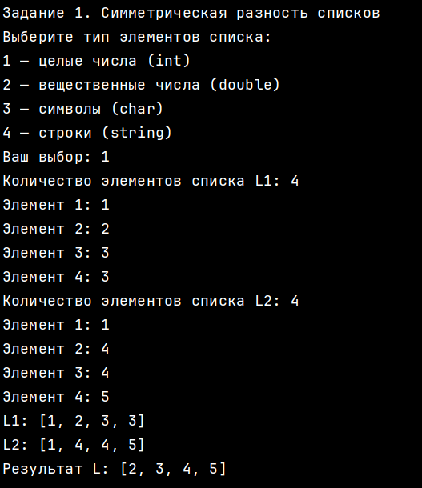

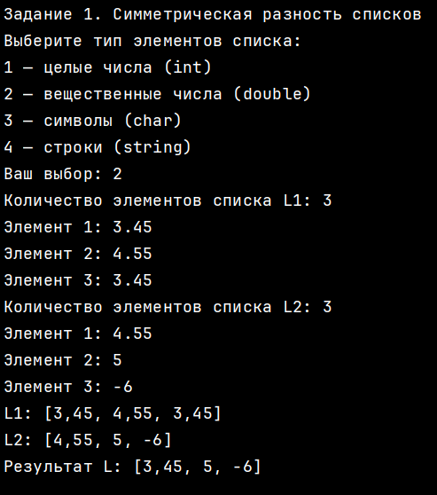

---

## Задание 2. LinkedList — Удаление элементов между min и max

### Текст задачи

Удалить все элементы между минимальным и максимальным элементами.

### Алгоритм решения

Список содержит целые числа (`LinkedList<int>`), так как минимум и максимум определяются сравнением чисел.

1. Метод `ReadLinkedList` считывает количество элементов (строго больше нуля) и сами элементы.
2. `FindMinNode` и `FindMaxNode` находят **узлы** первых вхождений минимального и максимального значений. Хранятся именно ссылки на узлы, а не только значения — это позволяет удалять элементы за O(1).
3. Если `minNode == maxNode` (все элементы равны), удалять нечего.
4. Метод `IsNodeBefore` определяет порядок следования узлов: если максимум расположен раньше минимума, границы меняются местами. Переменной `first` присваивается более ранний узел, `last` — более поздний.
5. Если `first.Next == last`, границы соседние и удалять нечего.
6. Иначе в цикле удаляются все узлы строго между `first` и `last`. Ссылка на следующий узел сохраняется **до** удаления (`next = current.Next`), иначе цепочка списка была бы потеряна. Сами граничные узлы остаются в списке.
7. Метод `RemoveBetweenMinMax` возвращает признак того, было ли что-то удалено, что позволяет вывести корректное сообщение.

Сложность — O(n): поиск минимума, максимума и порядка следования выполняется проходами по списку, каждое удаление — O(1).

### Тестирование

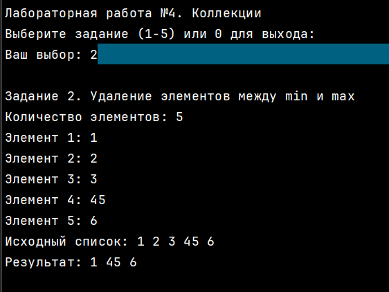

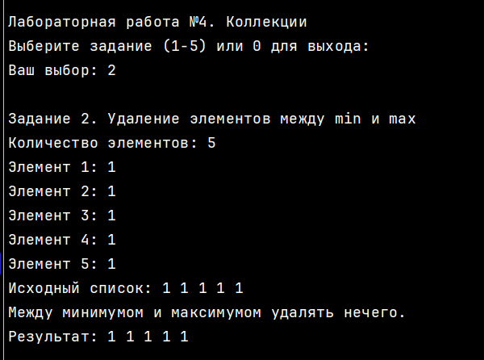

---

## Задание 3. HashSet — Анализ предпочтений телезрителей

### Текст задачи

Есть перечень названий телевизионных шоу. Определить для каждого наименования шоу, какие из них нравятся всем n телезрителям, какие — некоторым из телезрителей, и какие — никому из телезрителей.

### Алгоритм решения

1. Метод `ReadAllShows` считывает **весь перечень** шоу. Названия проверяются на уникальность без учёта регистра (`ContainsString`, `StringComparison.OrdinalIgnoreCase`), при совпадении ввод повторяется. Перечень задаётся заранее — иначе категория «не нравятся никому» всегда была бы пустой.
2. Метод `ReadViewers` считывает количество телезрителей и для каждого вызывает `ReadViewerFavorites`.
3. `ReadViewerFavorites` выводит нумерованный перечень шоу и предлагает ввести номера любимых шоу **одной строкой через пробел** (`0` — нет любимых). Строка разбивается `Split` с `StringSplitOptions.RemoveEmptyEntries`, каждый фрагмент проверяется `int.TryParse`. Пропускаются: нечисловые фрагменты, номера вне диапазона, повторно выбранные номера. Валидные номера преобразуются в названия и добавляются в `HashSet<string>` с компаратором `StringComparer.OrdinalIgnoreCase`.
4. `ClassifyShows` для каждого шоу подсчитывает, у скольких зрителей оно во множестве любимых (`HashSet.Contains` — O(1)), и распределяет по трём спискам:
   - число симпатий равно числу зрителей → нравится всем;
   - больше нуля, но меньше числа зрителей → нравится некоторым;
   - равно нулю → не нравится никому.
5. Результаты выводятся методом `PrintShows`; для пустой категории выводится соответствующее сообщение.

### Тестирование

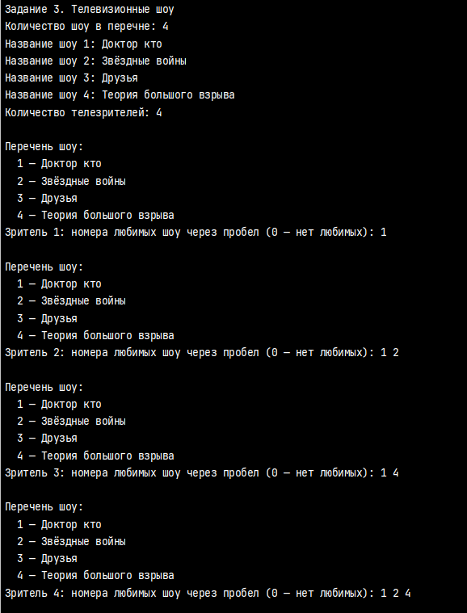

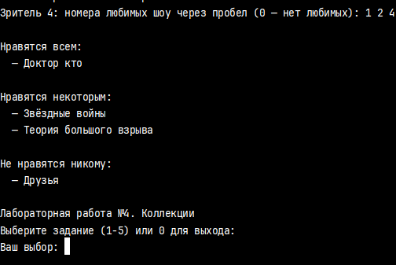

---

## Задание 4. HashSet — Цифры в тексте

### Текст задачи

Файл содержит текст на русском языке. Какие цифры встречаются в тексте?

### Алгоритм решения

1. Метод `ReadFillMode` предлагает выбрать способ заполнения исходного файла: случайная генерация или ручной ввод.
2. `FillTextFileRandom` записывает подготовленные русскоязычные строки и одно случайное число; `FillTextFileManual` построчно считывает текст с клавиатуры. Запись выполняется в кодировке UTF-8.
3. `PrintTextFile` выводит содержимое файла на экран для наглядной проверки.
4. `FindDigitsInFile` читает файл **построчно** (`StreamReader.ReadLine`), поэтому весь текст в память не загружается. Для каждого символа проверяется попадание в диапазон `'0'`–`'9'`, найденные цифры добавляются в `HashSet<char>`.
5. `HashSet` хранит только уникальные значения, поэтому дополнительная проверка на повторы не требуется.
6. `PrintDigits` выводит цифры в возрастающем порядке: перебираются символы от `'0'` до `'9'` и проверяется их наличие во множестве (`Contains` — O(1)). Если цифр нет, выводится соответствующее сообщение.

### Тестирование

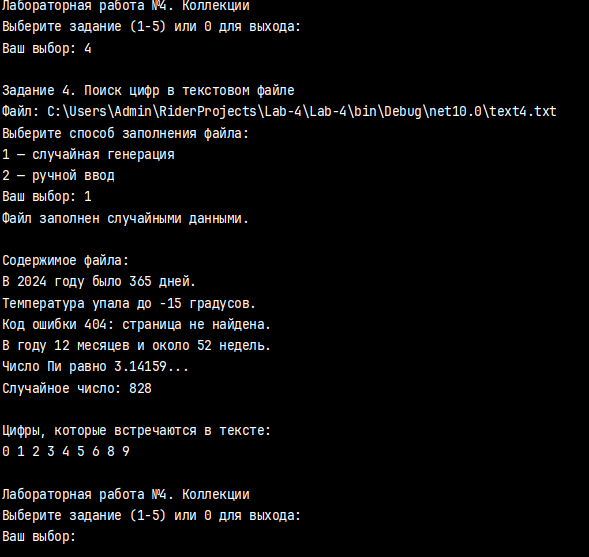

---

## Задание 5. Dictionary — Самый старший человек

### Текст задачи

Имеется список людей с указанием их фамилии, имени и даты рождения. Напишите программу, которая будет определять самого старшего человека из этого списка и выводить его фамилию и имя, а если имеется несколько самых старших людей с одинаковой датой рождения, то определять их количество.

Формат данных: в первой строке количество людей `N`, далее `N` строк вида `<Фамилия> <Имя> <ДД.ММ.ГГГГ>`. Фамилия и имя — не более 20 символов без пробелов, год — от 1800 до 2100.

### Алгоритм решения

Исходные данные хранятся в текстовом файле, заполнение вынесено в отдельный метод. Решение оптимально: **O(n) по времени и O(1) по памяти**. Новый тип данных не создаётся.

1. `FillPeopleFile` — отдельный метод заполнения исходного файла. Записывает `N`, затем `N` строк в формате по условию (разделитель — пробел). Фамилия и имя считываются методом `ReadPersonName`, который ограничивает длину 20 символами и запрещает пробелы; дата — методом `ReadBirthDate` (`TryParseExact` по шаблону `dd.MM.yyyy`, год 1800–2100).
2. `FindOldestPeople` выполняет **один проход** по файлу. Файл читается построчно, все записи в память не загружаются. Каждая строка валидируется: количество полей, длина фамилии и имени, корректность даты (в том числе календарная — 31.02 отвергается), диапазон года.
3. Поддерживается текущий минимум:
   - если дата **раньше** найденной — обновляется минимальная дата, запоминается ФИО, словарь очищается и в него добавляется пара «дата → 1»;
   - если дата **совпадает** — счётчик в словаре увеличивается;
   - если дата позже — запись игнорируется.
4. Используется `Dictionary<DateTime, int>`: ключ — дата рождения, значение — количество людей с этой датой. В словаре всегда **не более одной записи** — текущий минимум. Этого достаточно, потому что по условию ответ — либо одно ФИО, либо количество, поэтому хранить всех людей незачем.
5. `PrintOldestResult` выводит самую раннюю дату и либо ФИО (если человек один), либо количество людей с этой датой.

Группировка всех записей дала бы те же O(n) по времени, но O(n) по памяти, то есть была бы менее оптимальной. `SortedList` не подошёл: вставка в него O(n), суммарно O(n²). Сортировка всех записей заняла бы O(n log n).

### Тестирование

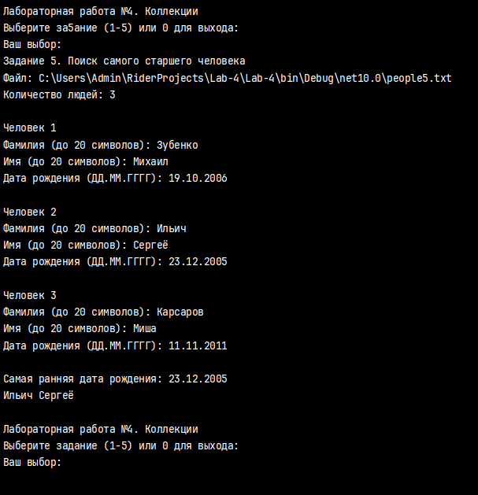

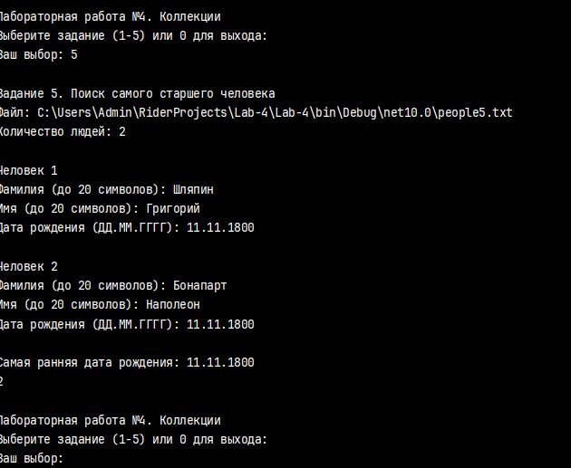

---

## Задание 6. Перегрузка операций (Money) — Вычитание копеек

### Текст задачи

Реализовать класс `Money` с полями `uint rubles`, `byte kopeks`. Вычитание копеек (`uint`) из объекта типа `Money` (учесть, что денежная величина не может быть меньше 0). Результат должен быть типа `Money`.

### Алгоритм решения

**Определение класса:**

- Приватные поля `_rubles` (`uint`) и `_kopeks` (`byte`) — инкапсуляция, прямой доступ извне закрыт.
- Свойство `Rubles` с явными `get` и `set` (автосвойства запрещены).
- Свойство `Kopeks` выполняет нормализацию: при установке значения больше 99 излишек переводится в рубли (`value / 100`), а в копейках остаётся остаток (`value % 100`). Дополнительно проверяется переполнение разряда рублей.
- Три конструктора: без параметров, с параметрами `(uint rubles, byte kopeks)` (нормализация выполняется через свойство `Kopeks`), конструктор копирования `Money(Money other)` с обработкой `null`.
- Переопределён `ToString()` — вывод в виде «X руб. Y коп.».

**Метод варианта — `SubtractKopeks(uint kopeks)`:**

1. Сумма переводится в общее количество копеек методом `ToTotalKopeks()`. Промежуточные вычисления выполняются в типе `ulong`, чтобы умножение рублей на 100 не вызвало переполнение `uint`.
2. Если вычитаемое количество копеек больше имеющейся суммы, выводится сообщение об ошибке и возвращается нулевая сумма — денежная величина не может быть отрицательной.
3. Иначе выполняется вычитание, и результат собирается методом `FromTotalKopeks`: рубли — целая часть деления на 100, копейки — остаток. При превышении диапазона `uint` выбрасывается `OverflowException`.
4. Исходный объект не изменяется — возвращается новый объект `Money`.

Протестированы все конструкторы (включая нормализацию копеек и независимость копии от оригинала), оба свойства, `ToString()` и метод варианта.

### Тестирование

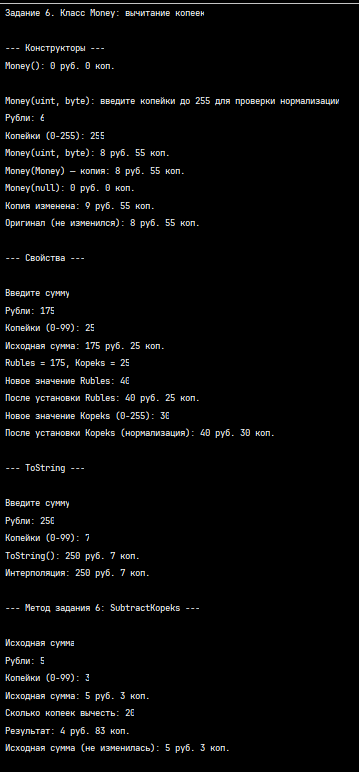

---

## Задание 7. Перегрузка операций (Money) — Полный набор

### Текст задачи

Добавить к классу `Money` перегруженные операции:

- **Унарные:** `--` вычитание копейки, `++` добавление копейки.
- **Приведение типа:** `uint` (явная) — количество рублей, копейки отбрасываются; `bool` (неявная) — `true`, если денежная сумма не равна 0.
- **Бинарные:** `- Money m, беззнаковое целое число` (лево- и правосторонние операции), число обозначает копейки; `- Money m1, Money m2` — вычитание денежных сумм.

### Алгоритм решения

Все операции выполняют вычисления через `ulong` и возвращают **новый** объект, исходные операнды не мутируются.

- **`operator ++`** — сумма переводится в копейки, увеличивается на 1, результат собирается обратно. Перенос разряда выполняется автоматически: 5 руб. 99 коп. → 6 руб. 0 коп.
- **`operator --`** — если сумма нулевая, выводится сообщение и возвращается копия (отрицательной суммы быть не может). Иначе вычитается одна копейка; при нулевых копейках «занимается» рубль: 5 руб. 0 коп. → 4 руб. 99 коп.
- **`explicit operator uint`** — возвращает `_rubles`. Приведение явное, так как копейки отбрасываются, то есть данные теряются.
- **`implicit operator bool`** — возвращает `true`, если рубли или копейки не равны нулю. Приведение неявное, так как информация не теряется; позволяет писать `if (money)`.
- **`operator -(Money, uint)`** — делегирует методу `SubtractKopeks`, поведение полностью совпадает с заданием 6.
- **`operator -(uint, Money)`** — правосторонняя операция: из указанного количества копеек вычитается сумма; при отрицательном результате возвращается нулевая сумма с сообщением.
- **`operator -(Money, Money)`** — обе суммы переводятся в копейки, проверяется, что вычитаемое не больше уменьшаемого, результат собирается обратно.

Пост- и пре-инкремент работают корректно: компилятор сам присваивает результат оператора обратно переменной, поэтому в `Money old = money++;` переменная `old` получает прежнее значение, а `money` — новое.

Дополнительно протестирована защита от переполнения: попытка увеличить максимальную сумму (`uint.MaxValue` руб. 99 коп.) и попытка установить копейки, переполняющие разряд рублей, приводят к `OverflowException`, которое перехватывается в тестирующем коде.

### Тестирование

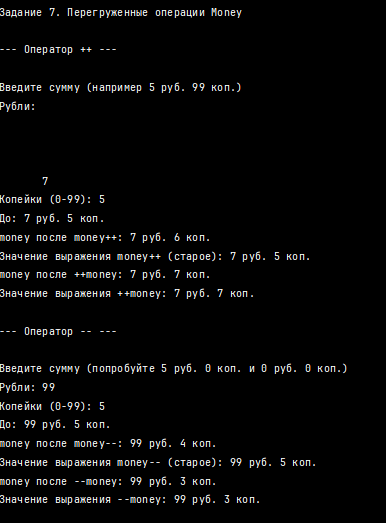

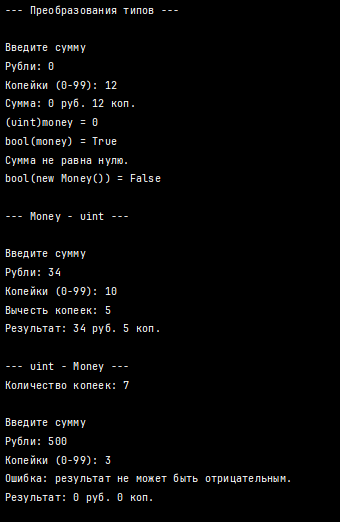

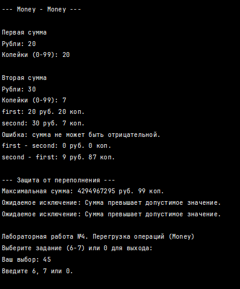

---

## Вывод

Все семь задач варианта 13 решены с соблюдением ограничений: без автосвойств, LINQ и лямбда-операторов. Задания 1–5 оформлены одним классом со статическими методами, вся логика вынесена в приватные вспомогательные методы, а методы `RunTaskN` содержат только последовательные вызовы. Задание 1 реализовано обобщённо и работает с любыми типами данных. Задание 5 решено оптимально — за один проход по файлу и с константным расходом памяти. В заданиях 6–7 реализованы и протестированы все конструкторы, свойства, метод варианта и все перегруженные операции.